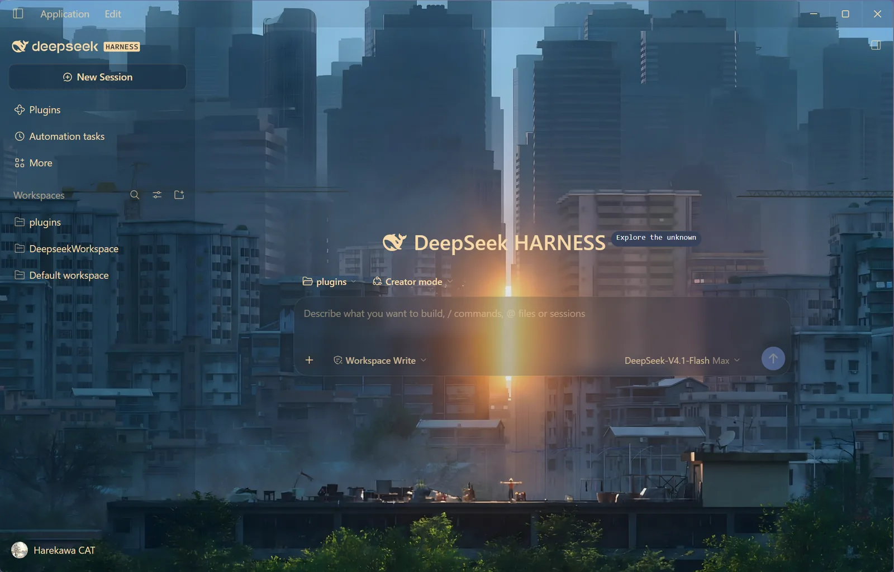
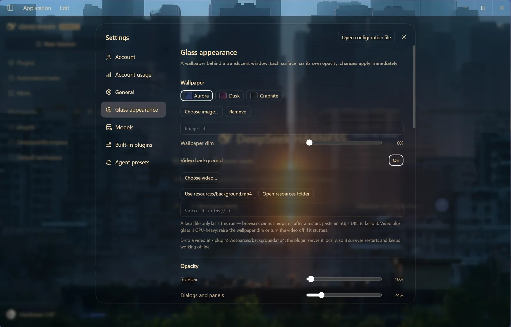
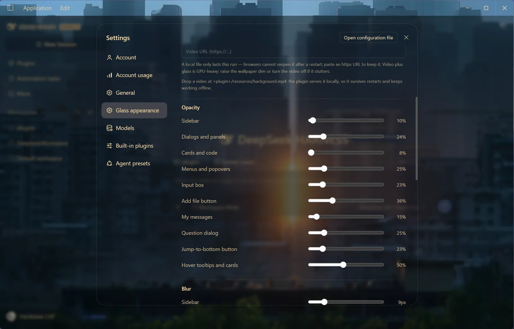
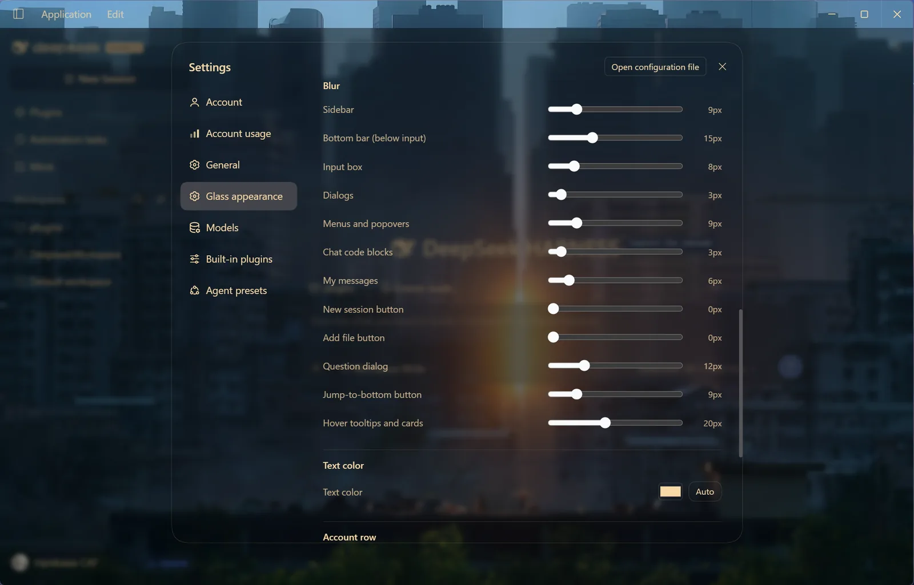
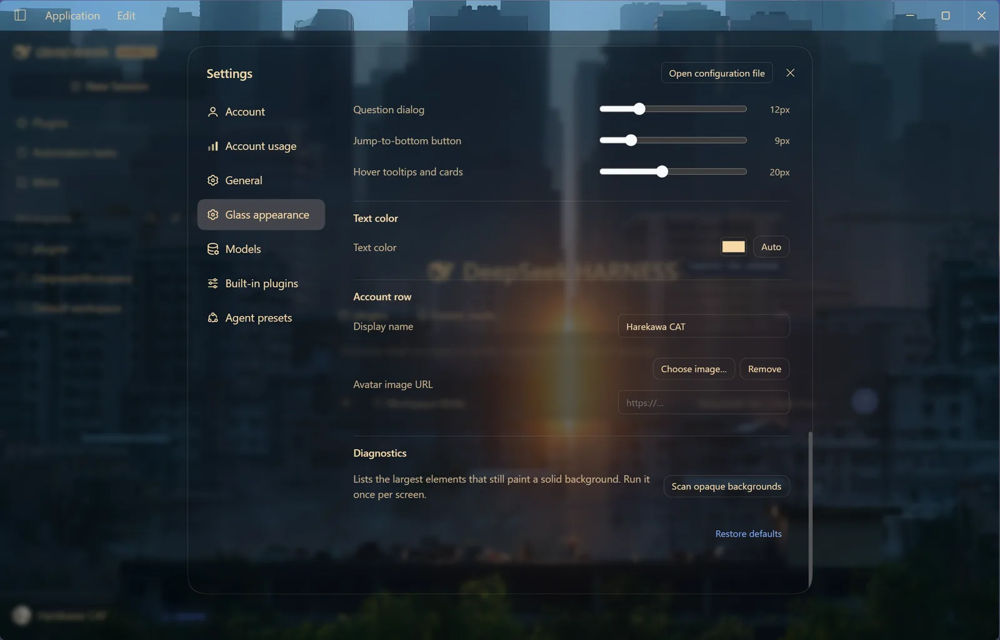

# 玻璃外观 · dsh-glass-appearance

给 [DeepSeek Harness](https://github.com/deepseek-ai/deepseek-harness) Web UI 加一层玻璃质感：背景图自定义，侧边栏、对话框、卡片、菜单、输入框、消息气泡可自定义透明度与模糊，允许文字颜色自定义，支持明暗不同版本；启动时还可以来一段开屏动画，或者换成你自己的视频。

A glass layer for the DeepSeek Harness Web UI — custom wallpaper, a launch splash (or your own video), per-panel opacity, per-panel blur, and a text color you pick.

> 非官方插件，与 DeepSeek 无隶属关系。基于 DSH `0.2.2-rc.1` 开发，`0.2.2-rc.5` 复验。



## 安装

方式一：

在 DSH 里让 Agent 执行：

```
plugin_manager(action: "install_bundle", target: "git+https://github.com/HarekawaCAT/DeepSeekHarness-Glass-Appearance.git")
```

方式二：

下载本仓库的 zip 并解压（解压后出现 `package.json`），然后：

```
plugin_manager(action: "install_bundle", target: "D:\\plugins\\dsh-glass-appearance")
```


安装后到 设置 - 玻璃外观 调整。

卸载：设置 - 插件里停用或移除，界面立即还原成默认外观。

## 有什么


3 套预设（极光 / 暮色 / 石墨），支持本地图片自定义，添加视频背景开关                                                       
背景遮罩提高文字可读性；视频模式下会降低视频不透明度

侧边栏/对话框与面板/卡片与代码块/菜单与弹层/输入框/添加文件按钮/消息气泡/确认目标对话框/回到底部按钮/悬停提示与详情框

侧边栏/底边栏/输入框/对话框/弹层与菜单/对话代码块/消息气泡/新会话按钮/添加文件按钮/确认目标对话框/回到底部按钮/悬停提示与详情框
自定义文字与按钮开关颜色

自定义左下角账号显示

开屏：每次打开页面播放一次，背景沿用你的壁纸，三种入场（淡入 / 缩放 / 上浮），可关、可调停留时长；也可以换成自己的视频（本地文件 / https 地址 / `resources/splash.mp4`），点击任意处或按 `Esc` 跳过。设置页有「预览」按钮，改完不用刷新就能先看一眼。

设置存在 localStorage（键 `dsh.glass-appearance.v3`），下次启动自动恢复；停用插件后完全还原。v2 的旧设置会自动迁移，1.8.x 的玻璃设置也会原样保留，只多出开屏这一组。

## 开屏

设置 → 玻璃外观 → 开屏。

- **动画开屏**：背景直接用当前壁纸（含遮罩），正中一行文字、两侧各一道向外淡出的横杠（字号 <code>clamp(20px,3.4vw,28px)</code>，窄屏自动缩小），三种入场：淡入 / 缩放 / 上浮；停留时长 0.8–4 秒可调。没有转圈、没有图标。
- **开屏文字**：默认 `DeepSeek HARNESS`，可在设置里改成自己的标语或项目名（留空即回默认，最多 48 字）。
- **视频开屏**：打开「视频开屏」后选来源——
  1. 「选择视频文件…」：本地文件，仅本次运行有效（浏览器重启后打不开旧的 blob 地址）；
  2. 填视频 `https://…` 地址：长期保留；
  3. 把片段放到 `<插件目录>/resources/splash.mp4`，点「使用 resources/splash.mp4」：由插件本地代发，重启后依然有效、离线可用（「打开 resources 文件夹」直接跳过去）。
- 视频一律静音播放（浏览器禁止带声音自动播放），放完或到「最长播放」后淡出；视频加载失败会自动回退到动画开屏，不会卡在黑屏。
- 跳过：点击任意处、按 `Esc`。系统开启「减少动态效果」时自动省掉入场动画。
- 「预览」按钮会用当前设置立刻放一次开屏，不影响存储的设置。

> 这层是加载时播一次，不是常驻层：刷新页面就会重新播；关掉「启动时播放开屏」即完全不出现。

## 图片背景

本地图片自定义，最长边 2200px ，避免报错，也可以直接填 `https://…` 图片地址

## 视频背景

「选择视频文件…」（本地，仅单次运行有效）、填视频 `https://…` 地址（长期保留）
1. 把视频放到 `<插件目录>/resources/background.mp4`（也支持 `.webm`）；
2. 设置 → 玻璃外观 → 背景 → 打开「视频背景」→ 点「使用 resources/background.mp4」。

## 兼容性

| DSH 版本 | 状态 |
|---|---|
| `0.2.2-rc.5` | 当前复验的版本（开屏与视频开屏在这版上跑通） |
| `0.2.2-rc.1` | 初版开发与验证的版本 |
| 其他 `0.2.x` | 预期可用；宿主大改类名时个别滑块可能失效，用「扫描不透明背景」自查 |
| `0.3.x` 及以后 | 未验证，`package.json` 的 `engines.dsh` 会阻止直接安装 |

只支持 Web GUI（`dsh.client.platform = web`），不涉及 TUI。

## 文件

| 文件 | 作用 |
|---|---|
| `index.js` | Host 半边：`/glass-assets/` 只读静态路由 |
| `client.js` | Client 半边：设置页、滑块、样式注入、背景与视频、开屏 |
| `cordis.patch.yml` | 插入 Host 插件行 |
| `locale/*.json` | 插件列表里的标题与描述 |
| `icon.svg` | 插件图标 |
| `resources/` | 视频/图片存放目录（内容不进 git）：`background.mp4` 背景视频，`splash.mp4` 开屏视频 |

## 许可证

[MIT](LICENSE)
